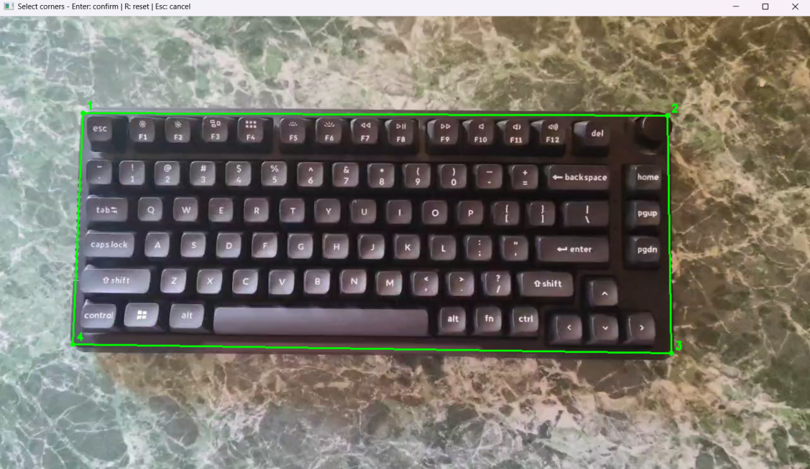

# Лабораторная работа 2, трекинг объектов

## Теоретическая база

**Трекинг объекта** — определение его положения на последовательности кадров. В этой работе плоский объект задаётся на первом кадре, который служит эталоном. На следующих кадрах его положение описывается четырёхугольником. При наклоне камеры дальняя сторона объекта может выглядеть короче ближней, поэтому рамка должна учитывать перспективу.

### Ключевые точки и SIFT

**Ключевая точка** — характерная деталь изображения, например угол буквы на клавише. **Дескриптор** — числовое описание окрестности точки. Координаты детали меняются при движении камеры, а дескриптор помогает узнать её на другом кадре.

SIFT строит изображения с разной степенью гауссова размытия и ищет локальные максимумы и минимумы в разностях соседних уровней. Так характерная деталь может обнаружиться на подходящем масштабе, даже если объект стал ближе или дальше. Слабоконтрастные и плохо локализованные точки отбрасываются. Для каждой оставшейся точки по градиентам яркости определяется основное направление. Окрестность описывается относительно этого направления, что уменьшает влияние поворота. Дескриптор содержит 128 чисел. Это восемь направлений градиента в каждой из 16 ячеек сетки $4\times4$.

Чтобы сопоставить дескрипторы, для каждой точки эталона находят два ближайших кандидата на текущем кадре. **Тест Лоу** оставляет пару, если отношение расстояний до первого и второго кандидатов достаточно мало.

### Гомография и RANSAC

**Гомография** — перспективное преобразование между изображениями одной плоскости. Для её оценки нужны минимум четыре пары точек в невырожденной конфигурации. Пары могут описывать детали внутри объекта. По вычисленной матрице переносятся четыре исходных угла, даже если сами углы среди найденных точек отсутствуют.

**RANSAC** строит модели по случайным подвыборкам и проверяет, сколько пар согласуются с каждой моделью. **Ошибка репроекции** — расстояние между предсказанным и найденным положением точки на текущем кадре. Пары с ошибкой в пределах порога называются **инлаерами**. Важно и то, как они распределены. Если все совпадения лежат около центра картины, они могут хорошо описывать центр, но слабо определять положение дальних углов.

### Оптический поток и Lucas–Kanade

**Оптический поток** описывает видимое движение деталей между кадрами. Оно может возникать как из-за движения объекта, так и из-за движения камеры. Если яркость движущейся детали примерно сохраняется, разложение по Тейлору даёт уравнение

$$
I_xu + I_yv + I_t \approx 0.
$$

Здесь $I_x$ и $I_y$ — пространственные производные яркости, $I_t$ — изменение яркости во времени, а $u$ и $v$ — компоненты скорости в плоскости изображения. Для одного пикселя получается одно уравнение с двумя неизвестными. Lucas–Kanade предполагает, что пиксели небольшого окна движутся примерно одинаково, и оценивает общее смещение методом наименьших квадратов. Углы и текстурированные области удобны для этого, поскольку яркость в них меняется в нескольких направлениях.

Пирамидальная версия сначала оценивает движение на уменьшенных изображениях, где то же смещение занимает меньше пикселей, а затем уточняет результат на более детальных уровнях. В отличие от сопоставления SIFT с первым кадром, поток опирается на положение точек в предыдущем кадре. После потери этих точек объект нужно найти заново.

### Уточнение рамки с помощью ECC

**ECC** (Enhanced Correlation Coefficient) — критерий сходства двух изображений по распределению яркости. Метод начинает с приблизительной гомографии и меняет её параметры, чтобы текстура текущей области лучше совместилась с эталоном. Например, если совпадения ключевых точек хорошо определили положение лица на портрете, но рамка перекошена, дополнительную информацию дают текстура одежды и детали по краям.

ECC работает как локальное уточнение, поэтому ему нужна черновая рамка, уже расположенная вблизи объекта. Сильное размытие затрудняет и поиск отдельных точек, и сравнение текстуры всей области.

## Описание системы

Итоговый вариант реализован на Python с OpenCV и NumPy. Запуск из папки лабораторной работы на примере собственного видео:

```powershell
py source/experimental.py videos/keyboard.mp4 results/exp/tracked_keyboard.mp4 --mode manual --label "Keyboard"
```

Первые два аргумента задают входное и выходное видео. Папка для результата должна существовать. Параметр `--label` задаёт подпись у рамки. Параметр `--mode` определяет, как выбирается объект на первом кадре:

- `full-frame` — режим по умолчанию. Эталоном служит весь первый кадр, а его углы задают исходную рамку.
- `manual` — пользователь отмечает четыре угла объекта по порядку вдоль контура и подтверждает выбор клавишей **Enter**. Клавиша **R** сбрасывает разметку. Идея интерактивного выбора области взята из примера OpenCV `plane_tracker.py`. В лабораторной области задаются четырьмя углами, чтобы можно было выделить объект, снятый под наклоном.



*Ручная разметка объекта на первом кадре собственного видео.*

Первый и последующие кадры переводятся в оттенки серого для вычислений. Рамка и подпись рисуются на исходных цветных кадрах.

1. **SIFT.** Признаки эталона вычисляются один раз. Каждый новый кадр сопоставляется с эталоном. После теста Лоу по оставшимся парам оценивается гомография с RANSAC и вычисляются новые координаты углов.
2. **Lucas–Kanade.** Если SIFT не дал рамку или оценка опирается на небольшое число инлаеров, программа при наличии предыдущей рамки проверяет движение точек внутри неё. Точки отслеживаются вперёд и назад, а по согласованным парам оценивается перенос рамки между соседними кадрами.
3. **ECC.** По предварительной рамке область текущего кадра приводится к прямоугольному виду. После нормализации локального контраста программа уточняет гомографию, совмещая текстуру области с эталоном. Поправка применяется, если она улучшает сходство и даёт допустимую геометрию.

Если надёжную предварительную рамку получить не удалось, кадр записывается без неё. Поиск по эталону продолжается на следующем кадре.

| Проверка | Порог |
| --- | --- |
| Тест Лоу для SIFT | Отношение расстояний меньше `0.75` |
| Ошибка репроекции RANSAC | `3.0` пикселя для SIFT и `1.7` пикселя для потока |
| Поддержка гомографии | Не менее 8 инлаеров и не менее 40% пар для SIFT или 65% для потока |
| Проверка точек Lucas–Kanade вперёд и назад | Ошибка возврата меньше `1.25` пикселя |
| Принятие поправки ECC | Итоговый коэффициент не ниже `0.55`, прирост больше `0.02` |

## Результаты

Сначала использовался только SIFT с гомографией. Затем был добавлен Lucas–Kanade для отслеживания между соседними кадрами, а в итоговой версии — ECC для уточнения перспективы рамки.

| Видео | Вариант | Кадры с рамкой | Результат |
| --- | --- | --- | --- |
| `mona-lisa-blur.avi` | SIFT | 260 / 558 | [Видео](results/sift/tracked_mona-lisa-blur.mp4) |
| `mona-lisa-blur.avi` | SIFT + Lucas–Kanade | 539 / 558 | [Видео](results/sift_with_LK/tracked_mona-lisa-blur.mp4) |
| `mona-lisa-blur.avi` | SIFT + Lucas–Kanade + ECC | 539 / 558 | [Видео](results/exp/tracked_mona-lisa-blur.mp4) |
| `mona-lisa-blur-extra-credit.avi` | SIFT + Lucas–Kanade + ECC | 521 / 558 | [Видео](results/exp/tracked_mona-lisa-blur-extra-credit.mp4) |
| `mona-lisa.avi` | SIFT + Lucas–Kanade + ECC | 558 / 558 | [Видео](results/exp/tracked_mona-lisa.mp4) |
| `keyboard.mp4` (собственное видео) | SIFT + Lucas–Kanade + ECC | 502 / 502 | [Видео](results/exp/tracked_keyboard.mp4) |

При использовании только SIFT рамка пропадала во время сильного размытия, а также когда камера отдалялась от картины и менялся угол обзора. На дальнем плане оставалось мало надёжных совпадений с первым крупным планом. Lucas–Kanade позволил продолжить трекинг между соседними кадрами на этом участке и увеличил покрытие с 260 до 539 кадров.

После добавления ECC число кадров с рамкой на `mona-lisa-blur.avi` осталось прежним. По визуальной проверке рамка на отдельных кадрах лучше соответствовала перспективе. Пропуски в итоговых прогонах размытых роликов связаны с кадрами, где сильное размытие мешало найти надёжные соответствия.

На собственном видео рамка появилась на всех 502 кадрах, и при просмотре трекинг выглядел стабильным, но и кадры были заметно чётче, а изменения ракурса — менее резкими, чем в тестовых роликах.

## Выводы по работе

Сопоставление SIFT с первым кадром позволяет заново найти объект после потери. Lucas–Kanade помогает сохранить рамку при постепенном изменении масштаба и ракурса, когда совпадений с эталоном становится мало. ECC уточняет положение углов по текстуре всей области и уменьшает перекос рамки. При сильном размытии часть кадров остаётся без разметки. Количество кадров с рамкой характеризует покрытие, а точность её положения в этой работе оценивалась визуально.

## Использованные источники

1. Презентации «2_ML_in_CV» и «Оптический поток».
2. [OpenCV — Introduction to SIFT](https://docs.opencv.org/4.13.0/da/df5/tutorial_py_sift_intro.html). Ключевые точки и дескрипторы SIFT.
3. [OpenCV — Feature Matching + Homography to find Objects](https://docs.opencv.org/4.13.0/d1/de0/tutorial_py_feature_homography.html). Сопоставление признаков, RANSAC и перенос углов.
4. [OpenCV — Optical Flow](https://docs.opencv.org/4.13.0/d4/dee/tutorial_optical_flow.html). Уравнение оптического потока и метод Lucas–Kanade.
5. [OpenCV — Object Tracking](https://docs.opencv.org/4.13.0/dc/d6b/group__video__track.html). Функции `calcOpticalFlowPyrLK()` и `findTransformECC()`.
6. [G. D. Evangelidis, E. Z. Psarakis — Parametric Image Alignment Using Enhanced Correlation Coefficient Maximization](https://pubmed.ncbi.nlm.nih.gov/18703836/). Метод совмещения изображений по ECC.
7. [OpenCV — plane_tracker.py](https://github.com/opencv/opencv/blob/4.x/samples/python/plane_tracker.py). Пример интерактивного выбора плоского объекта.