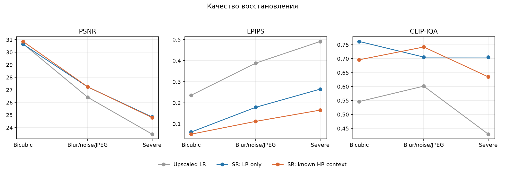

# Лабораторная работа № 3.2. Восстановление изображений с использованием диффузионных моделей

## 1. Теоретическая база

Super Resolution (SR) — задача восстановления изображения высокого разрешения (HR) по его деградированной версии (LR). 

Inpainting — восстановление неизвестных участков изображения с учётом доступного контекста. В данной работе эти задачи объединяются: низкокачественное изображение доступно полностью, а высококачественное — только за пределами заданной маски.

Бикубическая интерполяция вычисляет значения новых пикселей с помощью кубического ядра по двум пространственным осям. В отличие от обученных моделей, она не использует знания о структуре объектов и не способна содержательно восстанавливать утраченные детали.

Для восстановления используется предобученная модель ResShift v2 [1]. В отличие от классической диффузии, ResShift строит переход между качественным и деградированным представлениями изображения посредством постепенного сдвига остатка между ними и добавления гауссовского шума:

$$
z_t=(1-\eta_t)z_0+\eta_t z_{LR}+\kappa\sqrt{\eta_t}\varepsilon,
\qquad \varepsilon\sim\mathcal N(0,I).
$$

Здесь $z_0$ и $z_{LR}$ — латентные представления HR и увеличенного LR соответственно, $\eta_t$ — коэффициент сдвига, $\kappa$ — масштаб шума. Обратный процесс начинается с зашумлённого $z_{LR}$, а нейросеть на каждом шаге предсказывает чистый латент. Это позволяет выполнять восстановление за 15 шагов. ResShift выбрана вместо SUPIR [2] ввиду меньших вычислительных требований.

## 2. Описание разработанной системы

### 2.1. Подготовка данных

Используются изображения из валидационной выборки DIV2K [3]. Из каждого вырезается центральный фрагмент размером 256 × 256 пикселей, который служит эталоном HR. Для получения LR размером 64 × 64 последовательно применяются размытие, бикубическое уменьшение разрешения, аддитивный гауссовский шум и JPEG-сжатие в зависимости от выбранной конфигурации.

| Деградация | Коэффициент уменьшения | Радиус размытия | СКО шума | JPEG quality |
|---|---:|---:|---:|---:|
| bicubic | 4 | 0 | 0 | — |
| blur_noise_jpeg | 4 | 1,2 | 5 | 50 |
| severe | 4 | 3,2 | 18 | 15 |

Бинарная маска определяет неизвестную область (1) и известные HR-пиксели (0). В основном эксперименте восстанавливается центральный квадрат размером 128 × 128, занимающий 25% изображения.

### 2.2. Архитектура и алгоритм восстановления

Модель состоит из автоэнкодера VQGAN и диффузионной нейросети U-Net с блоками Swin Transformer. Автоэнкодер переводит изображение размером 256 × 256 × 3 в латент размером 64 × 64 × 3. Восстановление осуществляется в латентном пространстве, а исходное LR дополнительно передаётся в U-Net в качестве условия. Обучение и изменение весов модели не выполняются.

Для использования известного HR-контекста модифицирован обратный диффузионный процесс. Сначала формируется комбинированное изображение из известных HR-пикселей и бикубически увеличенного LR в неизвестной области.

На каждом из 15 шагов латент известного контекста приводится к текущему уровню диффузии функцией `q_sample()` и смешивается с текущим состоянием по латентной маске.

После смешивания функция `p_sample()` выполняет очередной обратный диффузионный переход. По завершении диффузии известные латентные позиции повторно фиксируются, результат декодируется и смешивается с HR в пиксельном пространстве.

Таким образом, HR-контекст влияет на восстановление неизвестной области, а финальное смешивание гарантирует точное сохранение известных пикселей.

### 2.3. Системные требования и запуск

Рекомендуется Python 3.10 или 3.11. Используются PyTorch 2.1.2 (CPU), torchvision, NumPy, Pillow, OmegaConf, LPIPS и PIQ. 

Вычисления выполняются на CPU в FP32 с ограничением внутрооперационного параллелизма до четырёх потоков. Для всей работы хватило устройства с 16Гб ОЗУ, 10Гб из которых были заняты.

Для запуска необходимо:
1. Установить зависимости командой `pip install -r requirements.txt`;
2. КЛонировать совместимую версию исходного кода [ResShift](https://github.com/zsyOAOA/ResShift);
3. Загрузить файлы `resshift_realsrx4_s15_v2.pth` и `autoencoder_vq_f4.pth` в папку `weights/`. 
4. Из lab3.2 эксперимент выполнить `py source/main.py`.

## 3. Результаты работы и тестирования системы

### 3.1. Описание используемых метрик

| Метрика | Назначение |
|---|---|
| PSNR ↑ | Пиксельное соответствие HR: $10\log_{10}(255^2/MSE)$ |
| LPIPS ↓ | Расстояние между признаками HR и результата (AlexNet) [4] |
| CLIP-IQA ↑ | Оценка воспринимаемого качества без эталона на основе CLIP [5] |

Метрики рассчитываются для всего изображения и отдельно для центральной восстанавливаемой области. Дополнительно PSNR рассчитывается непосредственно по пикселям маски. Для используемой прямоугольной маски результаты PSNR по маске и её ограничивающему прямоугольнику совпадают.

### 3.2. Количественные результаты

В таблице представлены средние значения метрик по девяти комбинациям изображений и деградаций. Основное сравнение проводится в пределах восстанавливаемой области (bounding box). Дополнительно приводится CLIP-IQA для изображения целиком.

| Метрика | lr_up | ones | zeros | paste_only | mixed |
|---|---:|---:|---:|---:|---:|
| PSNR (bbox), дБ ↑ | 26,854 | 27,574 | ∞ | 27,574 | 27,634 |
| LPIPS (bbox) ↓ | 0,3714 | 0,1681 | 0,0000 | 0,1681 | 0,1094 |
| CLIP-IQA (bbox) ↑ | 0,5257 | 0,7242 | 0,7472 | 0,7242 | 0,6907 |
| CLIP-IQA (full) ↑ | 0,5797 | 0,8192 | 0,8040 | 0,7391 | 0,8005 |

Для исследования влияния степени деградации отдельно представлены средние значения LPIPS восстанавливаемой области.

| Деградация | ones | mixed | Снижение LPIPS, % |
|---|---:|---:|---:|
| bicubic | 0,0610 | 0,0511 | 16,3 |
| blur_noise_jpeg | 0,1785 | 0,1118 | 37,4 |
| severe | 0,2647 | 0,1652 | 37,6 |

Полные результаты: [metrics.csv](results/metrics.csv).

### 3.3. Визуальные результаты

Визуально сравненить методы можно в директории `results/`.

Графики метрик качества:

## 4. Выводы по работе

В рамках лабораторной работы реализовано восстановление изображений с использованием предобученной модели ResShift v2 и итеративным внедрением известного HR-контекста в латентное состояние диффузии.

Диффузионное восстановление по LR показало преимущество над бикубической интерполяцией по всем трём усреднённым метрикам восстанавливаемой области: PSNR увеличилась на 0,719 дБ, LPIPS снизилась на 54,7%, а CLIP-IQA увеличилась на 0,1985.

Использование HR-контекста непосредственно в процессе диффузии позволило выявить следующие закономерности:

- LPIPS восстанавливаемой области снизилась во всех девяти экспериментах.
- PSNR увеличилась в среднем на 0,060 дБ, однако улучшение наблюдалось только в четырёх случаях из девяти. Существенного повышения пиксельной точности не выявлено.
- CLIP-IQA восстанавливаемой области снизилась с 0,7242 до 0,6907. При этом для изображения целиком внедрение HR-контекста в процесс восстановления обеспечило более высокую оценку по сравнению с простой подстановкой HR после диффузии: 0,8005 против 0,7391.
- Польза HR-контекста по LPIPS наиболее выражена при комбинированной и сильной деградациях: снижение метрики составило 37,4% и 37,6% соответственно против 16,3% при простом уменьшении разрешения.

Таким образом, использование известного HR-контекста в процессе диффузионного восстановления позволяет повысить перцептивное соответствие неизвестной области оригиналу, особенно при значительной потере информации в LR. При этом улучшение перцептивного соответствия не обязательно сопровождается повышением пиксельной точности и безэталонной оценки качества.

## 5. Использованные источники

1. [Yue Z., Wang J., Loy C. C. ResShift: Efficient Diffusion Model for Image Super-resolution by Residual Shifting. NeurIPS, 2023.](https://arxiv.org/abs/2307.12348) [Исходный код.](https://github.com/zsyOAOA/ResShift)
2. [Yu F. et al. Scaling Up to Excellence: Practicing Model Scaling for Photo-Realistic Image Restoration in the Wild. CVPR, 2024.](https://arxiv.org/abs/2401.13627)
3. [DIV2K Dataset.](https://data.vision.ee.ethz.ch/cvl/DIV2K/)
4. [Zhang R. et al. The Unreasonable Effectiveness of Deep Features as a Perceptual Metric. CVPR, 2018.](https://arxiv.org/abs/1801.03924)
5. [Wang J. et al. Exploring CLIP for Assessing the Look and Feel of Images. AAAI, 2023.](https://arxiv.org/abs/2207.12396)
